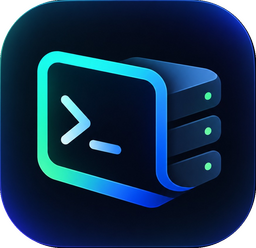

# TermX — klien SSH Android

  <a href="../../releases/latest">Unduh APK terbaru</a> ·
  <a href="CHANGELOG.md">Changelog</a> ·
  <a href="LICENSE">Lisensi MIT</a> ·
  <a href="README.md">English</a>

Klien SSH Android modern (terinspirasi alur kerja Termius), dibuat dengan Kotlin + Jetpack Compose.
Ketuk host untuk membuka **terminal**; pilih **Terminal tmux** (menu host, tab Sesi, atau tombol **+** di terminal)
untuk **sesi persisten**: shell berjalan di dalam `tmux` di server, sehingga program yang Anda jalankan
(Claude Code, build panjang, `tail -f`, dsb.) tetap hidup walau HP terputus, layar mati, atau aplikasi ditutup.
Saat tersambung lagi, TermX masuk ke sesi yang sama.

**Sesi tidak pernah berakhir sendiri.** Selama sesi belum Anda tutup, TermX terus menyambung ulang (termasuk saat
berganti Wi-Fi ↔ data; koneksi yang masih sehat, mis. lewat Tailscale, dibiarkan), memulihkan sesi setelah Android
mematikan aplikasi, dan menampilkan notifikasi tetap sampai Anda memutuskannya.

Aplikasi tersedia dalam **English** (default) dan **Bahasa Indonesia** — ganti di **Lainnya → Pengaturan → Bahasa**.

## Fitur

| Area | Isi |
|---|---|
| **Host** | Grup (warna bisa diubah), tag, pencarian, duplikat, jump host (bastion), keep-alive, perintah awal |
| **Ikon host** | Logo OS terdeteksi otomatis saat konek pertama (Ubuntu, Debian, Arch, Fedora, Rocky, Alpine, Raspberry Pi, Proxmox, macOS, Windows, …); bisa diganti logo OS lain, ikon bawaan, atau emoji |
| **Terminal** | Emulator xterm-256color + truecolor buatan sendiri (alt screen, scroll region, mouse SGR, bracketed paste, OSC title/clipboard), kontrol ala Termius (kembali, pil sesi dengan tutup, **+** sesi baru, keyboard), tombol tambahan (`esc` `tab` `shift+tab` `ctrl` `alt`, panah, F1–F12, bisa diatur), pinch-zoom, seleksi, 5 tema, font sendiri (.ttf/.otf, ligatur) |
| **Sesi** | Daftar sesi dengan pratinjau layar; pindah, tutup, atau buka sesi baru dari dalam terminal; sesi SFTP juga; riwayat layar disimpan per sesi; banner ASCII saat konek |
| **Sesi persisten** | Attach `tmux` (riwayat 50.000 baris, gulir dengan mouse), sambung ulang tanpa batas, daftar/attach/akhiri sesi tmux di server |
| **Latar belakang** | Foreground service sticky + wake/Wi-Fi lock, notifikasi tetap berisi sesi aktif, pulih setelah proses dimatikan / reboot / update, permintaan pengecualian optimasi baterai |
| **Autocomplete** | Saran perintah dari riwayat host, snippet, dan perintah umum; perintah yang tidak tampil (mis. password) tidak pernah disimpan |
| **Sudo** | Password sudo per host (atau password login); setelah **Anda** menjalankan `sudo`, prompt `[sudo] password for <user>` diisi otomatis; prompt lain hanya menampilkan tombol isi |
| **Snippet** | Kelola perintah dengan ikon pilihan dan opsi sudo; jalankan dari terminal (⚡) |
| **SFTP & editor** | Jelajah, unggah/unduh, ganti nama, hapus; **text editor** layar penuh dengan nomor baris, undo/redo, cari & ganti, auto-indent, baris simbol; buka/simpan file milik root dengan sudo |
| **Keychain** | Buat kunci Ed25519 / RSA, impor OpenSSH / PEM / PuTTY, pasang ke `authorized_keys` dengan satu ketuk, dan lihat server mana saja yang memakai kunci itu (cek / lepas) |
| **Keamanan** | Password & kunci privat dienkripsi AES-256-GCM dengan Android Keystore; verifikasi host key (TOFU, SHA-256) dengan peringatan bila berubah |
| **Port forwarding** | Lokal (-L), remote (-R), dinamis/SOCKS5 (-D); mulai otomatis |
| **Monitor** | CPU, RAM, swap, load, disk, jaringan, proses teratas, container Docker; mode **sudo** untuk server yang butuh root |
| **Cadangan** | Ekspor/impor konfigurasi (tanpa rahasia) |

## Instalasi

Unduh `TermX-vX.Y.Z.apk` dari [Releases](../../releases/latest) dan pasang di Android 8.0+ (izinkan instalasi dari
sumber tidak dikenal). Rilis baru bisa dipasang menimpa yang lama tanpa kehilangan data. Periksa unduhan dengan
file `.sha256` di setiap rilis.

## Versi & rilis

- Versi mengikuti [SemVer](https://semver.org/lang/id/) dan dicatat di [`CHANGELOG.md`](CHANGELOG.md).
- **Rilis**: tambahkan entri CHANGELOG, naikkan `termx.versionName` / `termx.versionCode` di `gradle.properties`,
  lalu buat tag `git tag vX.Y.Z && git push origin vX.Y.Z`. Workflow `release.yml` membuat APK bertanda tangan dan
  GitHub Release beserta checksum.
- **Build pengembangan**: setiap push ke `main` memperbarui pre-release `latest-debug`.

## Membangun

Kebutuhan: JDK 17, Android SDK 34. `./gradlew testDebugUnitTest assembleDebug` (APK di
`app/build/outputs/apk/debug/`), atau buka proyek di Android Studio.

Terjemahan ada di `app/src/main/res/values/strings.xml` (English) dan `values-in/strings.xml` (Indonesia).

## Lisensi

TermX dirilis di bawah [lisensi MIT](LICENSE). Komponen pihak ketiga memakai lisensinya masing-masing — lihat
[THIRD_PARTY_NOTICES.md](THIRD_PARTY_NOTICES.md). Laporan celah keamanan: [SECURITY.md](SECURITY.md).

## Catatan

- Port di bawah 1024 tidak bisa dibuka di HP tanpa root (port forwarding lokal/SOCKS).
- "Jaga koneksi di latar belakang" memakai wake lock (menambah konsumsi baterai); matikan di Pengaturan bila tidak perlu.
- Merek HP seperti Xiaomi, Oppo, Vivo, Huawei punya manajer baterai tambahan: izinkan juga "Autostart" untuk TermX.
- Logo OS dari [Simple Icons](https://simpleicons.org) (CC0); merek milik pemiliknya masing-masing.
